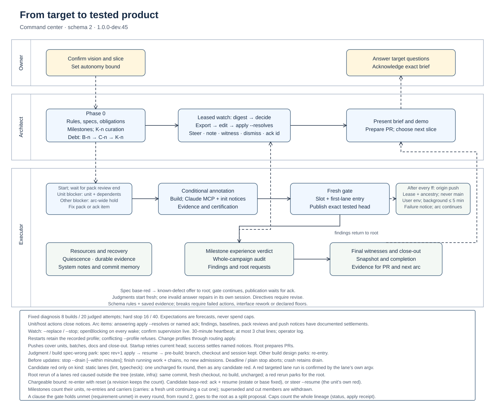

# roadmap-orchestration

A **roadmap-orchestrator** for Claude Code. Give it a detailed target-state document, a cut line and a codebase;
it decomposes the work into independently verifiable units, builds each in an isolated git worktree, and
converges the codebase on the documented target state, unattended, for a week or more at a time.

## Status

**1.0 is in prerelease on `main`** (`1.0.0-dev.33`). The command-center release uses runtime schema 2.
Arcs started on dev.32 or earlier are refused, not adopted; finish them with their original executor.
The last 0.x release is at tag `v0.20.0`.

## What 1.0 is

- A Node 24 executor (TypeScript, no runtime dependencies) that owns processes, deadlines, resources and git
  operations, with write-ahead recovery.
- A unit DAG with resource pools, system-based responsibility, executable witnesses and candidate-first publication.
- Five roles: build, verifier (pre-build/gate/diagnosis), pack review, milestone experience verdict and campaign audit.
- A root architect who authors and revises the target/plan through exported compare-and-swap inputs, supervises
  unattended work and brings the owner a canonical brief.
- Revisioned routing: `default` mixes eligible Codex builds with Claude judgments; `claude-only` needs no Codex CLI.

The binding design is [`DESIGN-1.0.md`](DESIGN-1.0.md); exact contracts are in
[`SCHEMAS.md`](plugins/roadmap-orchestrator/executor/SCHEMAS.md).

## Install

```
/plugin marketplace add ahmcgee/roadmap-orchestration
/plugin install roadmap-orchestrator@roadmap-orchestration
```

Then, in the repo you want to build in, run:

```
/roadmap-orchestrator:orchestrate
```

The first run bootstraps the repo and distils the vision with you (it runs the `vision` skill itself). Run
`/roadmap-orchestrator:vision` on its own later, between arcs, to recalibrate the vision, and
`/roadmap-orchestrator:estate-compaction` at any time to prune what the arcs have accumulated.

The skill installs a managed `/usr/local/bin/roadmap` launcher inside the executor container and refreshes
it on each skill session. Startup also ensures the **Roadmap web console**, normally at
`http://localhost:4747`, and prints its URL on stderr without changing JSON stdout. Developers can use
`roadmap tui` in another terminal. After startup and at completion, the architect shares the console URL
and an arc-pinned TUI command. Pin browser inspection with `/#/runs/<arc>/overview`; the initial page
follows this repo's live run, or its latest retained run. The launcher points to the installed plugin and
the current Node executable; no global npm package or copied executor is required.
For manual setup, run `node "<plugin root>/executor/bin/install-roadmap"` (with container administrator
rights if needed), or pass `--bin-dir <directory>` for a writable PATH directory. Unrelated commands are
never overwritten. Keep the plugin installed; refresh the launcher after updates or container rebuilds.

The console is a detached, read-only service. `roadmap console start|stop|status --repo <path>` controls
it independently of executor/watch; normal stop, completion, parking and supervisor death leave it
available. Explicit console stop persists until another start. Console bind failures, startup or mutex
timeouts, conflicts with a running console and failed termination leave arc work running with one loud
warning naming the cause and `.roadmap/config.json` `webConsole.port` or `roadmap console stop`.
Direct `roadmap console start` refuses these failures. Invalid configuration and programming errors still
refuse startup; a nonzero configured port never falls back to another port.

Start on Overview for the run state, current work, waiting reasons and open requests. Units lists every
unit and sorts by elapsed time, failed checks or spend. Open a unit to see its purpose and rounds, then
an agent activity for its live history or a check for its output. Activity shows recent journal events.
Successful housekeeping steps stay behind a toggle in Activity and unit journeys; failures remain visible.
Time & resources groups CPU measurements by unit and stage attempt, lists resource holds in words, and
tabulates recorded waiting by reason. Attention lists the exact terminal commands for human responses.
Times are relative, with local time on hover. Missing measurements are labelled, and stopped or completed runs retain their recorded time range. All views are read-only.

The executor normally runs in a devcontainer. The intended default, `0.0.0.0:4747`, makes the console
reachable from the host through the container's network interface. Set `webConsole.port` to `0` to bind
any free port, useful when several repos share one container. The lease records the actual bound port;
`roadmap console status` and the start/resume console line show its URL. There is **no authentication**: it
exposes plans, state, spend, questions and selected logs/results. On an exposed host, use loopback in the
existing `.roadmap/config.json`: `{"webConsole":{"host":"127.0.0.1","port":4747}}`. Hosts must be IP
literals; missing fields default without rewriting config. A zero port reuses the current live console; other binding changes need console stop/start, and
conflicting settings across worktrees are refused. For LAN sharing, replace the printed loopback address
with the host's reachable hostname/IP. Service metadata lives under the realpath Git common directory's
`roadmap-console/`, shared across worktrees and outside arc GC.

The page retains timestamped content and reports “Disconnected/stale” after five seconds without a
verified observation. Milestone nodes show executor gates, including when all member units have passed.
Time charts show partial recorded effort, not wall-time coverage; overlapping waiting reasons are never
summed and mixed-category waiting stays unallocated. CPU shows recorded reservations and measured
run/wall averages, without invented utilization histories, peaks or test-case counts. Assets ship with
the plugin; there is no runtime package installation or asset download.

Open an agentic activity's history from its unit to read the retained brief, thoughts, tool inputs/results
and final report. Active histories grow over SSE and follow the tail until you scroll up. Show earlier
and explicit expansion keep long transcripts bounded; deterministic activities keep their step logs.


For local testing before pushing: `/plugin marketplace add ./path/to/this/repo`.

## How an arc runs



The detailed process uses BPMN events, tasks, gateways and message flows: [docs/flow-bpmn.svg](docs/flow-bpmn.svg).

The **owner** confirms the vision, resolves questions only they can answer, and sets how far the architect may
chain arcs beyond the last acknowledged brief. The **architect** is the root agent in that conversation. The
**executor** runs detached and owns every workload, resource, evidence directory and integration ref.

1. **Bootstrap and Phase 0.** The architect curates the target corpus into stable T-n rules, compiles the confirmed
   vision, selects a useful slice and writes the pack outside the product tree: plan, specs, obligations, witnesses,
   census and Phase-0 record. Every unit names systems; every spec states intent and non-goals. Existing behavior is
   must-hold, future behavior names its delivering units. Milestones define usable end-to-end experiences with
   design references, bring-up, journeys and selected integration lanes. Approved compaction carries source-backed
   K-n curation; debt resolutions link B-n and K-n in the plain C-n ledger. Phase 0 checks typed inputs, committed
   target bytes, proof reachability and readiness; system overlap, possible future-witness vacuity, spanning proof and design ordering advise judgment.
2. **Start and review.** Startup validates the pack, claims the host and smokes its routed backends. A fresh pack
   review checks it against the target and census and must end before admission. Blocking unit findings hold the named
   units and their transitive dependents; other blocking targets hold the arc. The architect fixes the pack for a
   superseding review or acknowledges the item, including when it offers no options. The supervisor
   restarts crashed executors; runners keep workloads and terminal evidence durable across recovery.
   Restarts retain the arc’s recorded routing profile. A conflicting `start --profile` refuses; change profiles through a routing apply.
3. **Build and certify.** Ready units get isolated worktrees and atomic resource/CPU reservations. A conditional
   independent pre-build review annotates risky traits, non-local proof or changed meaning. Builders ground their
   specs first, implement, run targeted checks and report evidence. A judgment park or a build `spec-wrong` park
   re-opens after the architect applies a spec revision and runs `resume <unit>`: pre-build on the new rev, with
   branch, worktree and implementer session kept. Other build design parks require re-entry under a new unit id. Every Claude build gets the configured
   `walkthrough.mcp` servers. A declared server unavailable at init raises a non-blocking `walkthrough-mcp` notice,
   once per server/error signature; a later connected build or acting walk explicitly settles its named notices. Bring-ups list its member/design milestones and origin milestones of findings its spec
   `repairs` cites, once each in plan order; empty is valid. Without the config, builds get no servers and no new
   refusal. Codex builds have no MCP path; acting judges keep their own rules. Bootstrap still refuses browser
   journeys without this config. The executor quiesces workloads, captures evidence,
   salvages changes and tears resources down before running full lanes and witnesses. A fresh gate judges the diff,
   actual reach against intent/non-goals, and evidence-backed responses to standing findings. Failed checks and gate
   revisions feed fix rounds with original evidence and base comparisons. A lanes red the architect traces outside the
   tree (the estate it runs against, or infrastructure) is waived with `roadmap rerun <unit>/lanes#<n>/<lane> --cause
   estate|infra --evidence "<line>"`: the lanes run again at the same commit in a fresh checkout, every lane on its own
   argv, with no build. The red's charge stands; the rerun charges nothing and counts as one judged stage, once per lane
   per head. Green goes on to the gate; a red rerun parks `rerun-red` for the architect, and `resume <unit>` restores the
   waived decision (a waived bound park stands). A spec lane red on its diff base
   raises an arc notice with a known-defect apply fragment; the root names its fix unit. That lane gets no
   further fix round: the gate continues, while candidate publication waits for the notice to be resolved.
   Verification checkouts keep stable paths and ignored caches between series. Every judgment begins in a fresh named
   session; one invalid answer may be repaired in that same session, schema and checkout. Verifier directives
   accompany only a revise decision, including in annotation modes. Backend schemas use plain object roots
   and encode supported field constraints; property descriptions state remaining semantic rules.
   Walk and comparison evidence entries are exact saved file paths; explanations belong in report text.
   Free real-output replays and schema/parser parity checks guard the contract before paid probes.
4. **Publish the tested head.** An approved unit plans a candidate on the current integration tip and atomically takes the publication slot plus the first scheduled lane’s resources (spec first, otherwise the selected suite). A moved tip reselects the entry; unused entry resources are cleaned and released. Candidate lanes
   retain unit attribution; only a green exact head is fast-forwarded. Candidate reds durably name their cause,
   grading records (RUN or REUSED) and original evidence; a bounded park retains that diagnosis. A candidate red whose
   only red lanes are declared static checks (`kind: static`: lint, typecheck) gets one uncharged fix round of its own;
   a second is read as any candidate red. Every successful integration fast-forward
   (unit, repair batch, docs revision or close-out) queues a background push to `origin` with user credentials.
   Pushes use an explicit lease and require the remote tip to be an ancestor; `main` is never pushed. Startup
   retries the current head after a crash; an up-to-date remote is a no-op. Snapshots and retirement continue
   during network work, bounded by `PUSH_TIMEOUT_MS` (five minutes per attempt). `push-failed` and `push-diverged`
   are non-blocking arc notices, once per failure episode; later publication/startup retries, divergence only
   probes until ancestry is safe (or the notice is acked by id), and a later successful push explicitly settles
   the named notices. No `origin` records one quiet fact. The root no longer pushes arc branches by hand for CI;
   `roadmap pr` still prepares the stacked PR and its push is a no-op when already current. A spike
   answers a declared question and retires its gated report without merging. Cheap local checks run early;
   expensive local checks run on candidates, with scarce shared/cross-system checks at batch/milestone boundaries.
5. **Judge the experience and campaign.** Once milestone units retire, its selected lanes run and one experience
   role walks its journeys and judges polish comparisons. Breaks hold downstream work; deviations can be repaired
   alongside it. A break requires a failed product action, an interface repair that reworks dependents, or a measured
   declared floor violation. Copy, visuals, diagnostics and stale docs against a correct interface deviate; sanctioned
   choices are not findings. Fresh whole-range campaign audits run at milestones, on request and at the final boundary, judging
   invariants, vacuity, interactions and document drift together. Audits report findings and root requests; the
   architect changes the plan and alone authorizes obligation dispositions. Audit dismissal requests await the root;
   `dismiss F-n --counter-evidence "<line>"` records its evidence-backed decision, including for P1 findings.
6. **Supervise from the command center.** The architect watches actionable events and reads `status --summary` for
   progress, spend versus expectations, milestone verdicts, caught counts and waste. Watch includes a fixed 30-minute
   heartbeat; each wake gets at most three chat lines. One actionable watch holds the arc’s lease: start or switch
   versions with `watch --actionable --replace`, end with `watch --stop`, and confirm supervision is live in status.
   Every transition and heartbeat repeats all open blocking items in `openBlocking`; act on each item on every wake.
   Before a plugin update, use `roadmap stop --drain [--within <min>]` and wait for the run to end, then
   update and `roadmap start`. Drain admits no new tasks or stages; running stages/jobs record their normal
   outcomes and required build-to-teardown and ff-to-snapshot chains finish before cleanup and stop.
   The optional deadline escalates to abort; a later plain `stop` escalates immediately. A crash retains the drain
   and deadline. Plain `stop` keeps its immediate abort behavior. Status shows the drain and deadline.
   Interventions and every arc-wide control go in the external operator log. The root never patches the plugin or run directory. To change inputs, export the
   current pack, edit it, then `apply --from <dir> --rev <N> --reason "<line>"`. Edited files must still match their
   exported base; untouched files take current bytes, and edited specs advance automatically. Steer cancels an
   unfinished unit into a directed round; note informs its next build without interruption. Unit/host actions close
   their notices. Resolve an audit’s arc requests with the apply that answers them: add `--resolves nu-ID[,nu-ID...]`. Unit requests require that unit’s change/re-entry and grouped findings require every named repair. No-op/stale applies close nothing; the receipt lists actual closures. Other arc items accept named `ack <id>` after review.
   A passing later baseline settles baseline items; a superseding review settles pack-review items. Finding requests
   close when their findings settle or a root apply supplies all named repairs. Dismissal suppresses the same finding
   on unchanged code. Supplied ack choices must be offered. External witnesses are explicit root attestations
   with head-bound file/URL evidence. No output matching substitutes for proof.
7. **Close out and check in.** Final audit, witnesses, batch lanes, document publication and snapshots settle before
   completion. The architect prepares the stacked PR, presents `brief` and the demo/rough edges, then acknowledges
   the exact brief only after the owner does. Another arc starts only within the chain bound and while the vision
   calls for work.

The architect records owner answers with `roadmap answer P-n --text "<answer>"` and applies answers affecting this arc
immediately. Open questions retain working assumptions; chaining within the acknowledged bound need not wait for every
answer. Each lane series runs earlier reds first, then cadence order, stopping at the first red. Explicit `timeoutMin`
yields a timeout red; without it the six-hour runner backstop applies. Eligible certified passes reuse only when their
execution/environment identity and input hashes match. A lane with `testArgv` runs only the changed leaf tests inside its
own cwd (a changed test elsewhere runs its whole argv), and a red targeted run is confirmed by the lane's own argv, whose
verdict counts: a runner that finds no test files never charges the unit.

Diagnosis begins at 8 builds or 20 judged build/lanes/gate attempts, counting interrupted and uncharged work. It
supplies a note and moves remaining mixed-profile builds to Claude. The fixed 16-build/40-stage boundary raises an
attempt-cap item for the architect. Spend expectations are forecasts, never caps. Usage limits park a backend until
explicit resume. Non-blocking waste findings advise the architect; they do not rewrite the plan.

System responsibility is not a file fence: paths beyond declared systems become gate input. Protected roadmap and
pinned corpus paths remain guarded. `docs/systems/<system>.md` (configurable) is non-normative build memory, edited
through ordinary gated diffs; normative claims stay in the corpus. Commit bodies retain captured summaries and
structured decisions, making later work and crash recovery intelligible.

Certification allows three uncharged reds before the fourth charges (defaults); witnesses-missing counts in that
allowance. Gate revisions and candidate reds have separate bounds. Re-entry keeps lineage counters; `reenters.reset`
with a reason clears chargeable failures while lifetime attempts and other counters remain. A re-entry must repair
the recorded cause, such as a surviving mutant or dirty lane outputs. Fresh build sessions with earlier lineage receive
a handover of diagnosis, findings, unmet clauses, witness failures, decisions and original evidence. Exact witness ids
can be checked with `witness-check --lane-file` before requesting certification.

A same-commit red→green run is flaky; unit-tree flakes need repair, while eligible tip flakes can be forgiven and mint
deflake units. Stochastic k-of-n lanes follow their declared rule instead. Ordering parks wake when their named blockers
merge. Managed environments start lazily, stay up while used and stop when idle; failed up/probe parks retryably rather
than counting as a red test. CPU reservations calibrate from completed runs; judgments and one workload can progress
under the host-pressure brake. Startup refuses foreign residues until cleaned or isolated, allowing proven own-arc
residues to recover. Checkout permission residue parks only its unit. Restore ownership or remove the
checkout, then `roadmap resume <unit>` reconciles its unfinished cleanup in-process; no executor restart is needed.

For live or retained observation, use `roadmap tui --repo <path> --arc <id>`. It refreshes without runtime writes;
closing it leaves execution running. The header separates executor liveness, active workloads and signed-in Claude
five-hour/weekly usage (read-only five-minute observation with cached fallback). Documents and logs use recorded
revision/commit identities, so unapplied working-tree edits are excluded.

| TUI control | View / behavior |
|---|---|
| 1–4; Tab / arrows | Dependency map, Activity, Estate, Exceptions |
| x / g / a | Expand Activity / toggle map context / reveal retained history |
| c / m / r / R | Show settled map nodes / next milestone / next or previous running item |
| Enter / Space | Open selected logs/document; expand an Estate collection |
| /, n, N, Esc | Search/jump forward/back; clear search then return |
| r in details; b | Raw/readable record; original repair input when retained |
| ? | Contextual controls |

Map selection links Activity by recorded unit/milestone/lineage; rows retain the actual unit. Estate leads with vision,
slice and plan, then naturally ordered document collections and debt. Missing evidence stays explicit. Historical
future-obligation checks say pre-delivery, and mutation detections remain distinct from product failures. A stopped
executor gets a STOPPED banner; informational viewer diagnostics do not become runtime exceptions. The persistent
`node test/fixtures/tui-lineage-demo.ts` example (from executor/) prints a launcher for inspecting replacement lineage.

The `vision` skill owns target dialogue and confirmation. The `estate-compaction` skill records owner-approved
reductions of rules, obligations, root ledger text and debt for the next Phase 0. Approved records wait outside product
in `roadmap-inputs/compaction.md` and apply through normal validated input edits. PR review/CI fixes likewise
become root-authored units, preserving the same gates and evidence.

## Layout

```
.claude-plugin/marketplace.json     # this marketplace
plugins/roadmap-orchestrator/
  .claude-plugin/plugin.json
  executor/                         # the 1.0 executor (TypeScript on Node 24)
  skills/orchestrate/               # SKILL.md, reference.md (every command), RATIONALE-1.0.md
  skills/vision/                    # SKILL.md: distil and calibrate the arc's vision in dialogue
  skills/estate-compaction/         # SKILL.md: prune the accumulated estate with you, applied at Phase 0
docs/flow.svg                       # how an arc runs: simplified overview
docs/flow-bpmn.svg                  # how an arc runs: the detailed process in BPMN
DESIGN-1.0.md                       # binding 1.0 design brief
```

## Development

From `plugins/roadmap-orchestrator/executor/`: `npm run typecheck` → `npm test` → `node evals/probe.ts` (real
CLIs) → the role evals in `evals/roles/` that the batch's changes trigger → the paid fixtures (`evals/m1/`, and
`evals/m5/`, the UI end to end, when milestones, walks, design units or the demo changed), once per merged batch.
See `CLAUDE.md`.
